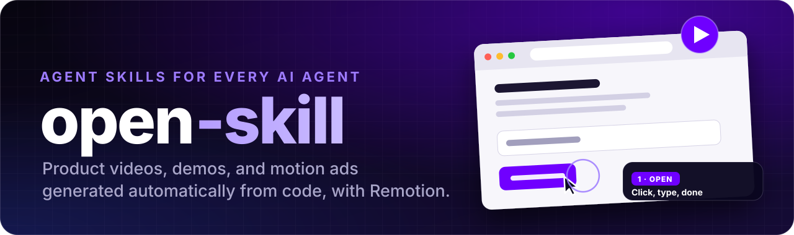
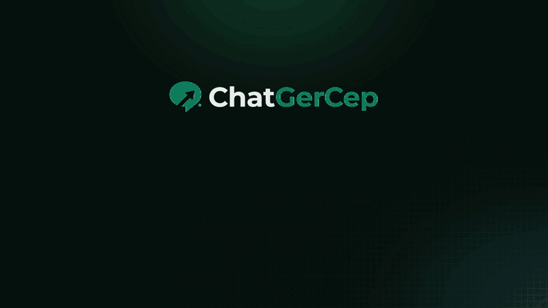
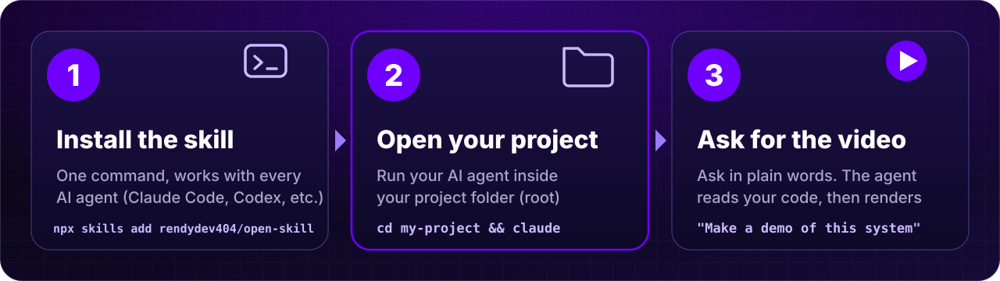
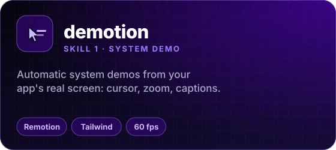
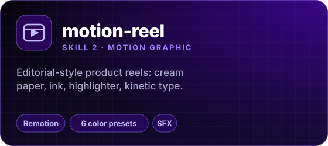
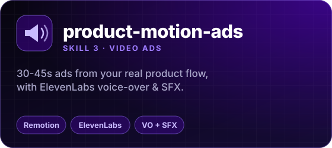
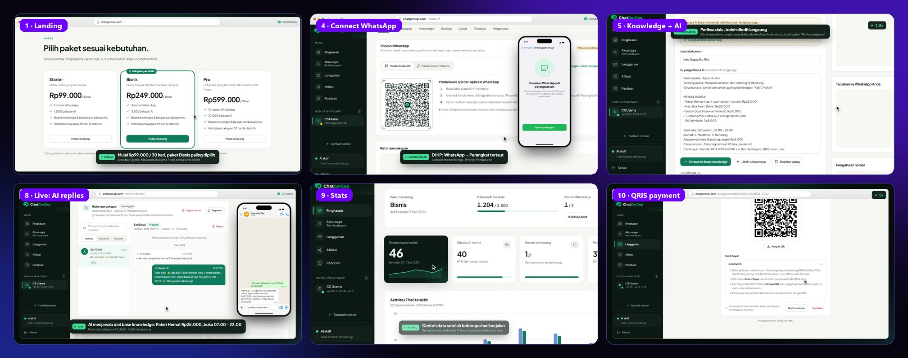

<div align="center">

<a href="README.md"></a><a href="README.en.md"></a>

<br><br>



<br>


<br><br>

**[How to use](#-how-to-use)** &nbsp;·&nbsp; **[Skills](#-skills-in-this-repo)** &nbsp;·&nbsp; **[AI agents](#-supported-ai-agents)** &nbsp;·&nbsp; **[Install](#-install)** &nbsp;·&nbsp; **[Requirements](#-requirements)** &nbsp;·&nbsp; **[Layout](#-repository-layout)** &nbsp;·&nbsp; **[FAQ](#-faq)**

</div>

<br>

**open-skill** is a collection of *Agent Skills* that turn a single prompt into a **product video rendered with
[Remotion](https://www.remotion.dev)**: a system demo built from your app's real screen, an editorial-style motion-graphics reel, or a
full video ad with voice-over and sound effects.

The skills use the open [Agent Skills](https://agentskills.io) format (a folder with a `SKILL.md`), so they **work with every AI agent
that supports it**: Claude Code, Codex, Cursor, Gemini CLI, GitHub Copilot, OpenCode, Cline, Windsurf, Roo Code, Hermes Agent, and
70+ more ([full list](#-supported-ai-agents)).

Everything is *video as code*: smooth 30-60 fps, repeatable, and easy to update when your product changes.

<div align="center">
  
  <br>
  <sub>Excerpt of a demo video generated by the <code>demotion</code> skill from the real UI of an app (intro, sign-up, connecting WhatsApp, stats). The demo app's UI is in Indonesian.</sub>
</div>

<br>

# 🚀 How to Use

<div align="center">
  
</div>

## 1️⃣ Install the skill (once)

```bash
npx skills add rendydev404/open-skill
```

One command for every AI agent installed on your computer. Other ways (manual copy, a specific agent) are in the [Install](#-install) section.

## 2️⃣ Open your project folder, then run the agent inside it

> [!IMPORTANT]
> **Run your AI agent inside the folder of the project you want a video for.**
> The skills read your project's code (pages, components, UI copy, prices, rules) so the video uses your **real** UI and facts,
> not made-up ones. So `cd` into the project first, then start the agent.

```bash
cd ~/projects/my-app           # your project folder (repo root)
claude                         # or: codex · gemini · opencode · any agent you use
```

Using an editor/IDE (Cursor, Windsurf, VS Code + Copilot, Cline, Roo Code, etc.)? Open the project folder via **File → Open Folder**, then open the agent panel.

## 3️⃣ Ask for the video in plain language

| Skill | Example prompt | Open the project folder? | Output |
|---|---|---|---|
| 🎬 **demotion** | `Use the demotion skill: make a demo video of this system from its real UI, 2 minutes max.` | **Required** (your web app's project folder) | `video/out/demo.mp4` |
| 📰 **motion-reel** | `/motion-reel QRIS payment feature coral 30 seconds` | Recommended (so real product copy is read); works without a project if you describe it | `out/reel.mp4` in the working folder the agent names |
| 📣 **product-motion-ads** | `Make a 40-second video ad for this product with English voice-over.` | Recommended; needs an ElevenLabs account & MCP for audio | `promo-video/out/promo.mp4` |

In agents without slash commands (`/skill-name`), just mention the skill in your sentence: "use the motion-reel skill to ...".

<details open>
<summary><b>⚙️ What happens after you send the prompt?</b></summary>

1. The agent **reads your project's code**: routes, components, copy, prices, rules, and brand colors/fonts.
2. It writes a storyboard and **sets up a Remotion project** (first run needs `npm install`, about 2 minutes; Node.js required).
3. It writes the scenes, **checks the result through images**, fixes issues, then **renders** (a 2-minute 60 fps demo takes about 8 minutes).
4. It tells you **where the video file is** (and sends it to you if the agent supports that).

</details>

<details>
<summary><b>💡 Tips</b></summary>

- **Monorepo?** Open the web app's folder, not the parent folder.
- **You don't need to run the app.** `demotion` takes the UI from the code, not from a running browser.
- **New feature?** Ask: "update the demo after feature X was added". The agent updates only the changed scenes and re-renders.
- **Different length/style?** Just say so: "90 seconds max", "English captions", "coral color".
- **The agent asks a question?** That's normal: the skills only ask what can't be inferred from the code (e.g. duration or must-show parts).

</details>

---

## ✨ Skills in this repo

<table>
  <tr>
    <td width="33%" valign="top">
      <a href="#-demotion"></a>
    </td>
    <td width="33%" valign="top">
      <a href="#-motion-reel"></a>
    </td>
    <td width="33%" valign="top">
      <a href="#-product-motion-ads"></a>
    </td>
  </tr>
</table>

| Skill | Output | Good for | Format |
|---|---|---|---|
| 🎬 **[demotion](skills/demotion)** | A screen recording **from your app's real UI**: natural cursor, camera zoom, smooth scrolling, educational captions | System demos, product tours, new-feature walkthroughs | 1080p · 60 fps · 1-2 min |
| 📰 **[motion-reel](skills/motion-reel)** | Editorial-style product/feature reel: cream paper, ink, highlighter, kinetic typography, SFX | Feature launches, short promos, explainers | 1080p · 30 fps · 20-45 s |
| 📣 **[product-motion-ads](skills/product-motion-ad)** | A motion-graphics ad that follows the product flow, with **ElevenLabs voice-over & SFX** | SaaS/app/product ads, promo videos with sound | 1080p · 30 fps · 30-45 s |

> The folder of the third skill in this repo is named `product-motion-ad` (same as its name in `SKILL.md`).

---

## 🎬 demotion

> **Automatic system demos from your app's real screen.** Looks like a professional Screen Studio-style recording, but it is driven
> entirely by code: no choppy captures, no re-takes.

<div align="center">
  
  <sub>Frames from a 1 min 57 s demo video made with <code>demotion</code> (landing, connecting WhatsApp, AI knowledge, live chat, stats, QRIS payment).</sub>
</div>

### Why it's different

- **Real UI, not an imitation.** Markup, Tailwind classes, color tokens, and fonts are copied from the app's code; UI copy is verbatim.
- **Truth comes from the code.** Every claim in a caption (prices, quotas, defaults) is verified against the code before it is written.
- **Smooth 60 fps motion.** A cursor that curves naturally, click ripples, automatic camera zoom, smooth scrolling. All computed from video time.
- **Product knowledge on screen.** Captions explain *what*, *why*, and the *rules*, not just point at buttons.
- **1-2 minutes.** Waiting is cut, typing/loading is sped up 3-8x (with a "4x" badge).
- **Easy to update.** New feature? Update the related scene and re-render.

### Workflow

```mermaid
%%{init: {"theme":"base","themeVariables":{"primaryColor":"#1a0f40","primaryTextColor":"#ffffff","primaryBorderColor":"#6F00FF","lineColor":"#9D7BFF","fontFamily":"Inter, sans-serif"}}}%%
flowchart LR
    A["📂 App code"] --> B["🔎 Product research"]
    B --> C["🗺️ Storyboard"]
    C --> D["🏗️ Remotion scaffold"]
    D --> E["🎞️ Scenes from real UI"]
    E --> F["⚡ Cut & speed up"]
    F --> G["🔍 Verify (stills)"]
    G --> H["🚀 Render 1080p 60 fps"]
    H --> I["📦 Compress & deliver"]
```



### Example prompts

```text
Use the demotion skill: make a demo video of this system from its real UI, 2 minutes max.
```
```text
/demotion update the demo after the QRIS payment feature was added
```

### How the engine works, in brief

Every scene is a pure function of time; the script only says *"the cursor arrives at this element at second N"*. Cursor position,
scrolling, and camera are measured from the DOM on the frame being rendered, so they never drift even when the layout changes.

```ts
const script: Script = {
  cursor: [
    { at: 0,   to: [1100, 500] },
    { at: 2.0, to: "signup-button", click: true },
    { at: 5.0, to: "name-input", kind: "text", click: true },
  ],
  scroll: [{ at: 0, to: 0 }, { at: 9.5, to: "sec-pricing", align: -64, dur: 2 }],
  camera: [{ at: 0, zoom: 1 }, { at: 4.5, zoom: 1.35, focus: "name-input", dur: 1 }],
};
```

<details>
<summary><b>What's inside the skill</b></summary>

| Part | Purpose |
|---|---|
| `SKILL.md` | Principles, 8 work phases, list of pitfalls |
| `templat/` | Ready engine: `Stage` (browser window + cursor + camera + scroll), captions, WhatsApp phone, cut/speed-up map, example scene |
| `skrip/scaffold.mjs` | Creates a complete video project in one command |
| `skrip/lembar-kontak.py` | Video contact sheet (one image with a frame every N seconds) for visual checks |
| `skrip/kompres.mjs` | A lightweight (H.264) copy small enough to send |
| `skrip/bersihkan-proses.ps1` | Kills leftover Remotion render processes (prevents renders slowing down 3x) |
| `referensi/` | Engine architecture, 23 pitfalls + fixes, storyboard & caption guide, subagent brief template, render & delivery |

```bash
node ~/.claude/skills/demotion/skrip/scaffold.mjs --dest ./video --nama "Product" --domain product.com --aksen "#6F00FF" --install
```

> The skill's own files (folder names, scripts, reference docs) are written in Indonesian; the agent reads them either way.

</details>

---

## 📰 motion-reel

> **Editorial-style product reels.** Cream paper, ink, highlighter, bold sans paired with italic serif, a thin HUD frame, directional
> motion blur, rolling numbers, 3D bento cards, kinetic type on color blocks, logo reveal. Audio is SFX only.

- Output **1920×1080 · 30 fps** MP4; one config file (`src/reel.config.ts`) controls the whole video.
- **Customizable colors**: pick a preset or give hex values; every other token is derived automatically.
- Reads the product's real copy from the code (i18n, page components, README) so claims in the video are true; it never invents metrics.

| Preset | Character |
|---|---|
| `lime` | the reference look (default) |
| `coral` · `ocean` · `sunset` · `violet` | highlighter color variants |
| `night` | dark version |
| `#hex` | your own brand color (`accent`, then `secondary`, optionally `paper` & `ink`) |

**Scene sequence** (about 45 s, pick what fits): `spark` → `word` → `tagline` → `bento` → `checklist` → `steps` → `formula` →
`showcase` → `stats` → `kinetic` → `logo`. Short cut (about 20 s): `spark` → `word` → `tagline` → `kinetic` → `logo`.

```text
/motion-reel QRIS payment feature coral 30 seconds
```

<details>
<summary><b>Workflow & style rules</b></summary>

1. **Read the request** (product/feature, colors, copy language) and read the product's code if available.
2. **Scaffold** `template/` → `npm install && npm run sfx`.
3. **Write `reel.config.ts`**: theme, scenes, copy (copy length limits are in `references/config.md`).
4. **Check & render**: `tsc`, `npm run render`, `npm run frames` (contact sheet every 1.5 s), fix, render once more.
5. **Deliver** `out/reel.mp4` with a per-scene summary.

Style: Inter Tight 800 for statements, Instrument Serif italic for the *twist*, JetBrains Mono for labels/HUD; expo-out easing for
entrances, smear/zoom-blur transitions, no shake and no white flashes.

</details>

---

## 📣 product-motion-ads

> **Motion-graphics video ads for any product** (SaaS, apps, digital/physical goods) with Remotion, complete with
> **ElevenLabs voice-over & sound effects**. The ad follows the *product usage flow*, and every scene proves one advantage.

- Output **1920×1080 · 30 fps · 30-45 seconds**: strong hook, human-sounding VO, professional SFX, fast transitions.
- **The product is clear within the first 8 seconds**: product name + "does what for whom".
- **One VO sentence = one scene = one advantage + its visual proof** (a form being filled, a button clicked, a result card appearing, numbers counting up).
- **Facts from the product's own sources**: landing copy, onboarding, feature names in the UI; illustrative numbers are flagged as illustrative.
- **Audio**: single-take VO → word-level transcript (Scribe) → automatic timeline (each scene starts just before its opening phrase is spoken) + a 10-file SFX pack.
- Can imitate the **transition style of a reference video** (frames are extracted and analyzed).

```text
Make a 40-second video ad for this product with English voice-over and ElevenLabs SFX.
```

<details>
<summary><b>What's inside the skill</b></summary>

| Part | Purpose |
|---|---|
| `template/` | Tested Remotion project: `primitives`, `scenes`, `Promo`, `theme`, VO/SFX scheduling |
| `references/script-and-storyboard.md` | How to write the script & storyboard (3-beat hook, one line ≤ 10 words per scene) |
| `references/elevenlabs.md` | Creating single-take VO, Scribe transcript, and the SFX pack |
| `references/example-*.tsx.txt` | Full 13-scene examples from a real project |
| `scripts/contact-sheet.cjs` | Contact sheet for visual checks |

</details>

---

## 🤖 Supported AI agents

> **Not tied to a single agent.** The skills in this repo follow the open [Agent Skills](https://agentskills.io) specification, so the same
> folder can be read by **79 AI agents** through the `skills` installer ([vercel-labs/skills](https://github.com/vercel-labs/skills)).

`Claude Code` `Codex` `Cursor` `Gemini CLI` `GitHub Copilot` `OpenCode` `Cline` `Windsurf` `Roo Code` `Kilo Code` `Goose` `Amp` `Antigravity` `Droid` `Kiro CLI` `Trae` `Qwen Code` `Continue` `OpenHands` `Junie` `Warp` `Zed` `Hermes Agent` `Augment` `Crush` `Mistral Vibe` `Replit` `Kimi Code CLI` `Tabnine CLI` `Devin for Terminal` <br>**...and 49 more agents.**

<details>
<summary><b>📜 Full list of agents & their folders</b></summary>

<br>

| Agent | `--agent` flag | Global folder |
|---|---|---|
| AiderDesk | `aider-desk` | `~/.aider-desk/skills/` |
| Amp, Replit, Universal | `amp`, `replit`, `universal` | `~/.config/agents/skills/` |
| Antigravity | `antigravity` | `~/.gemini/antigravity/skills/` |
| Antigravity CLI | `antigravity-cli` | `~/.gemini/antigravity-cli/skills/` |
| AstrBot | `astrbot` | `~/.astrbot/data/skills/` |
| Autohand Code CLI | `autohand-code` | `~/.autohand/skills/` |
| Augment | `augment` | `~/.augment/skills/` |
| IBM Bob | `bob` | `~/.bob/skills/` |
| Claude Code | `claude-code` | `~/.claude/skills/` |
| OpenClaw | `openclaw` | `~/.openclaw/skills/` |
| Cline, Codex, Dexto, fx, Kimi Code CLI, Loaf, Pi, Sarvam Code, Warp, Zed | `cline`, `codex`, `dexto`, `fx`, `kimi-code-cli`, `loaf`, `pi`, `sarvam-code`, `warp`, `zed` | `~/.agents/skills/` |
| CodeBuddy | `codebuddy` | `~/.codebuddy/skills/` |
| Codemaker | `codemaker` | `~/.codemaker/skills/` |
| Code Studio | `codestudio` | `~/.codestudio/skills/` |
| Command Code | `command-code` | `~/.commandcode/skills/` |
| Continue | `continue` | `~/.continue/skills/` |
| Cortex Code | `cortex` | `~/.snowflake/cortex/skills/` |
| Crush | `crush` | `~/.config/crush/skills/` |
| Cursor | `cursor` | `~/.cursor/skills/` |
| Deep Agents | `deepagents` | `~/.deepagents/agent/skills/` |
| Devin for Terminal | `devin` | `~/.config/devin/skills/` |
| Droid | `droid` | `~/.factory/skills/` |
| Eve | `eve` | `N/A (project-only)` |
| Firebender | `firebender` | `~/.firebender/skills/` |
| ForgeCode | `forgecode` | `~/.forge/skills/` |
| Gemini CLI | `gemini-cli` | `~/.gemini/skills/` |
| GitHub Copilot | `github-copilot` | `~/.copilot/skills/` |
| Goose | `goose` | `~/.config/goose/skills/` |
| Grok Build | `grok` | `~/.grok/skills/` |
| inference.sh | `inference-sh` | `~/.inferencesh/skills/` |
| Jazz | `jazz` | `~/.jazz/skills/` |
| Junie | `junie` | `~/.junie/skills/` |
| iFlow CLI | `iflow-cli` | `~/.iflow/skills/` |
| Kilo Code | `kilo` | `~/.kilo/skills/` |
| Kimchi | `kimchi` | `~/.config/kimchi/harness/skills/` |
| Kiro CLI | `kiro-cli` | `~/.kiro/skills/` |
| Kode | `kode` | `~/.kode/skills/` |
| Lingma | `lingma` | `~/.lingma/skills/` |
| MCPJam | `mcpjam` | `~/.mcpjam/skills/` |
| MiniMax Code | `minimax-code` | `~/.minimax/skills/` |
| Mistral Vibe | `mistral-vibe` | `~/.vibe/skills/` |
| Moxby | `moxby` | `~/.moxby/skills/` |
| Mux | `mux` | `~/.mux/skills/` |
| OpenCode | `opencode` | `~/.config/opencode/skills/` |
| OpenHands | `openhands` | `~/.openhands/skills/` |
| Ona | `ona` | `~/.ona/skills/` |
| Posit Assistant | `posit-assistant` | `~/.posit/assistant/skills/` |
| Qoder | `qoder` | `~/.qoder/skills/` |
| Qoder CN | `qoder-cn` | `~/.qoder-cn/skills/` |
| Qwen Code | `qwen-code` | `~/.qwen/skills/` |
| Reasonix | `reasonix` | `~/.reasonix/skills/` |
| Rovo Dev | `rovodev` | `~/.rovodev/skills/` |
| Roo Code | `roo` | `~/.roo/skills/` |
| Tabnine CLI | `tabnine-cli` | `~/.tabnine/agent/skills/` |
| Terramind | `terramind` | `~/.terramind/skills/` |
| Tinycloud | `tinycloud` | `~/.tinycloud/skills/` |
| Trae | `trae` | `~/.trae/skills/` |
| Trae CN | `trae-cn` | `~/.trae-cn/skills/` |
| Windsurf | `windsurf` | `~/.codeium/windsurf/skills/` |
| ZCode | `zcode` | `~/.zcode/skills/` |
| Zencoder, Zenflow | `zencoder`, `zenflow` | `~/.zencoder/skills/` |
| Neovate | `neovate` | `~/.neovate/skills/` |
| Pochi | `pochi` | `~/.pochi/skills/` |
| PromptScript | `promptscript` | `N/A (project-only)` |
| AdaL | `adal` | `~/.adal/skills/` |
| `allowed-tools` |  | `Yes` |
| `context: fork` |  | `Yes` |

Source: the [official `skills` documentation](https://github.com/vercel-labs/skills/blob/main/docs/agents.md). The installer detects the
agents installed on your computer automatically; if none is detected, you are asked to choose.

</details>

> **Compatibility note.** The instructions inside the skills occasionally mention Claude Code-specific features (sending files to the user,
> parallel subagents, `/skill-name` invocation). In other agents, those steps are replaced by that agent's equivalent (e.g. saving the result in
> an `out/` folder and telling you where it is). The core work (reading the code, writing Remotion scenes, rendering, verifying) is the same in every agent.

---

## 🚀 Install

### ⚡ Fastest way (any agent)

```bash
npx skills add rendydev404/open-skill
```

The installer finds the three skills, detects the AI agents installed on your computer, and installs them into the right folders.

```bash
npx skills add rendydev404/open-skill --skill demotion              # a single skill
npx skills add rendydev404/open-skill --agent claude-code codex     # specific agents
npx skills add rendydev404/open-skill -g                            # global (all projects)
npx skills add rendydev404/open-skill --all                         # every skill, every agent, no prompts
```

### 📋 Manual copy

A skill is a folder with a `SKILL.md`. Copy the folders from `skills/` into your agent's skills folder (see the [agent list](#-supported-ai-agents)).
Examples for a few popular agents:

| Agent | Global folder (all projects) | Project folder |
|---|---|---|
| Claude Code | `~/.claude/skills/` | `.claude/skills/` |
| Codex, Cline, Warp, Zed, Pi | `~/.agents/skills/` | `.agents/skills/` |
| Cursor | `~/.cursor/skills/` | `.agents/skills/` |
| Gemini CLI | `~/.gemini/skills/` | `.agents/skills/` |
| GitHub Copilot | `~/.copilot/skills/` | `.agents/skills/` |
| OpenCode | `~/.config/opencode/skills/` | `.agents/skills/` |
| Windsurf | `~/.codeium/windsurf/skills/` | `.windsurf/skills/` |
| Roo Code | `~/.roo/skills/` | `.roo/skills/` |

<details>
<summary><b>macOS / Linux</b></summary>

```bash
git clone https://github.com/rendydev404/open-skill.git
mkdir -p ~/.claude/skills          # replace with your agent's folder
cp -r open-skill/skills/* ~/.claude/skills/
```

</details>

<details>
<summary><b>Windows (PowerShell)</b></summary>

```powershell
git clone https://github.com/rendydev404/open-skill.git
New-Item -ItemType Directory -Force "$env:USERPROFILE\.claude\skills" | Out-Null   # replace with your agent's folder
Copy-Item -Recurse -Force .\open-skill\skills\* "$env:USERPROFILE\.claude\skills\"
```

</details>

**Just one skill?** Copy only the folder you want, e.g. `skills/demotion`. **Updating?** `git pull` (or run `npx skills update`) and copy again.
Restart the agent session so the skills are picked up.

---

## 🧰 Requirements

| Requirement | Used by | Notes |
|---|---|---|
| An AI agent that supports [Agent Skills](https://agentskills.io) | all | Claude Code, Codex, Cursor, Gemini CLI, Copilot, etc. ([list](#-supported-ai-agents)) |
| Node.js (LTS) + npm | all | Remotion, scaffold, render |
| FFmpeg | all | bundled with Remotion (`npx remotion ffmpeg`), no separate install needed |
| GPU (optional) | `demotion` | rendering with `--gl=angle` is about 1.5x faster |
| Python 3 + Pillow (optional) | `demotion` | for the contact sheet used in visual checks |
| An [ElevenLabs](https://elevenlabs.io) account & MCP | `product-motion-ad` | VO and SFX |

---

## 📁 Repository layout

```text
open-skill/
├── README.md                    # Bahasa Indonesia
├── README.en.md                 # English
├── LICENSE
├── assets/                      # banners, skill cards, previews (en/ = English versions)
└── skills/
    ├── demotion/                # system demos from the real screen
    │   ├── SKILL.md
    │   ├── referensi/           # architecture, pitfalls, storyboard, fork brief, render
    │   ├── skrip/               # scaffold, contact sheet, compress, cleanup
    │   └── templat/             # ready-to-copy Remotion engine
    ├── motion-reel/             # editorial reels
    │   ├── SKILL.md
    │   ├── references/
    │   └── template/
    └── product-motion-ad/       # ads + ElevenLabs VO & SFX
        ├── SKILL.md
        ├── references/
        ├── scripts/
        └── template/
```

---

## ❓ FAQ

<details>
<summary><b>How is a skill different from a plugin or an MCP server?</b></summary>

A skill is just instructions plus supporting files that the agent loads when needed. No server or process runs.
`product-motion-ad` uses the ElevenLabs MCP for audio; the other two skills need no external service.

</details>

<details>
<summary><b>Where is the skills folder on Windows?</b></summary>

It depends on the agent. For Claude Code: `C:\Users\<name>\.claude\skills\` (PowerShell: `$env:USERPROFILE\.claude\skills`). For other agents see the "Global folder" column in the [agent list](#-supported-ai-agents).

</details>

<details>
<summary><b>Is demotion only for specific apps?</b></summary>

No. The engine is generic: you copy your own app's UI (Tailwind/React) into scenes. The examples in this README come from the author's
demo product, but the bundled template is neutral (`templat/src/scenes/contoh.tsx`).

</details>

<details>
<summary><b>Is it only for Claude Code?</b></summary>

No. The skills follow the open [Agent Skills](https://agentskills.io) specification and can be used by **79 AI agents**: Claude Code,
Codex, Cursor, Gemini CLI, GitHub Copilot, OpenCode, Cline, Windsurf, Roo Code, Kilo Code, Goose, Amp, Antigravity, Droid, Kiro CLI,
Trae, Qwen Code, Continue, OpenHands, Junie, Warp, Zed, Hermes Agent, and more (see the [full list](#-supported-ai-agents)).
Instructions that mention Claude Code-specific features (sending files, subagents, `/skill-name`) are mapped to equivalents by the other agents.
They were built and tested in Claude Code; behavior in other agents may vary.

</details>

---

## 📄 License

Released under the [MIT license](LICENSE): free to use, modify, and share, including in commercial projects.

---

<div align="center">

Made by **[@rendydev404](https://github.com/rendydev404)** · Videos rendered with **[Remotion](https://www.remotion.dev)**

<sub>If this repo helps you, a ⭐ is appreciated.</sub>

</div>
