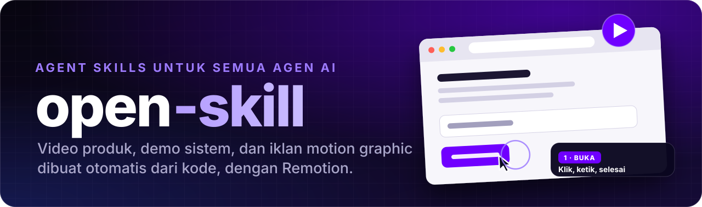
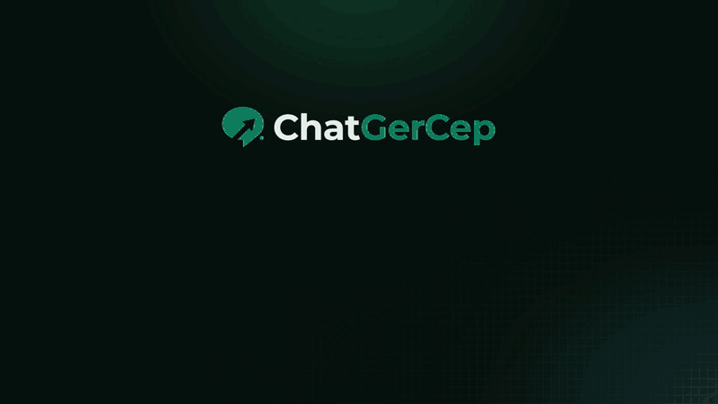
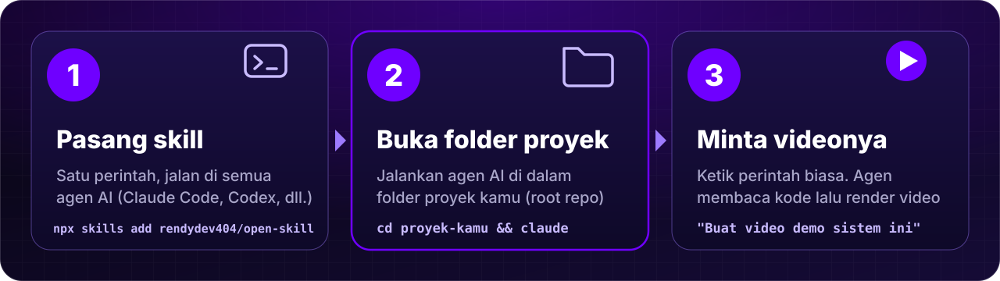
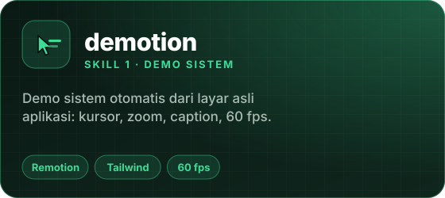
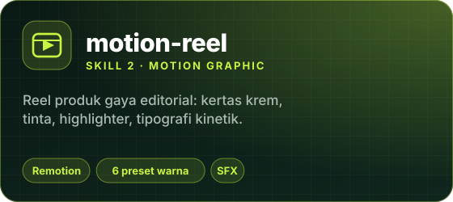
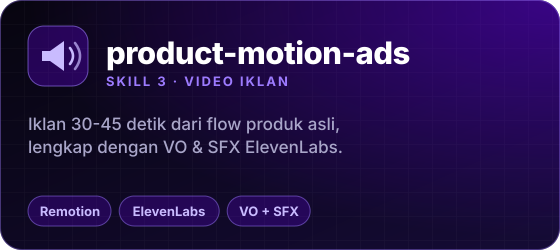
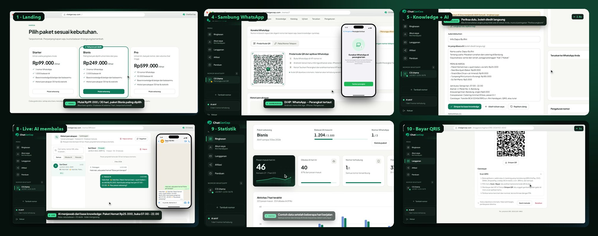

<div align="center">

<a href="README.md"></a><a href="README.en.md"></a>

<br><br>



<br>


<br><br>

**[Cara pakai](#-cara-pakai)** &nbsp;·&nbsp; **[Skill](#-skill-di-repo-ini)** &nbsp;·&nbsp; **[Agen AI](#-agen-ai-yang-didukung)** &nbsp;·&nbsp; **[Pasang](#-pasang)** &nbsp;·&nbsp; **[Prasyarat](#-prasyarat)** &nbsp;·&nbsp; **[Struktur repo](#-struktur-repo)** &nbsp;·&nbsp; **[FAQ](#-faq)**

</div>

<br>

**open-skill** adalah kumpulan *Agent Skills* yang mengubah satu perintah menjadi **video produk yang dirender dengan
[Remotion](https://www.remotion.dev)**: demo sistem dari layar asli aplikasi, reel motion graphic bergaya editorial, sampai
video iklan lengkap dengan voice over dan sound effect.

Skill ditulis dengan format terbuka [Agent Skills](https://agentskills.io) (folder berisi `SKILL.md`), jadi **bisa dipakai oleh
semua agen AI yang mendukungnya**: Claude Code, Codex, Cursor, Gemini CLI, GitHub Copilot, OpenCode, Cline, Windsurf, Roo Code,
Hermes Agent, dan 70+ lainnya ([daftar lengkap](#-agen-ai-yang-didukung)).

Semuanya *video sebagai kode*: mulus 30-60 fps, bisa diulang, dan gampang diperbarui saat produk berubah.

<div align="center">
  
  <br>
  <sub>Cuplikan video demo yang dihasilkan skill <code>demotion</code> dari tampilan asli aplikasi (intro, daftar, sambung WhatsApp, statistik).</sub>
</div>

<br>

# 🚀 Cara Pakai

<div align="center">
  
</div>

## 1️⃣ Pasang skill (sekali saja)

```bash
npx skills add rendydev404/open-skill
```

Satu perintah untuk semua agen AI yang terpasang di komputermu. Cara lain (salin manual, agen tertentu) ada di bagian [Pasang](#-pasang).

## 2️⃣ Buka folder proyekmu, lalu jalankan agen di dalamnya

> [!IMPORTANT]
> **Jalankan agen AI di dalam folder proyek yang mau dibuatkan videonya.**
> Skill membaca kode proyekmu (halaman, komponen, teks UI, harga, aturan) supaya video memakai tampilan dan fakta yang **asli**,
> bukan karangan. Jadi masuk ke folder proyek dulu, baru jalankan agen.

```bash
cd ~/proyek/aplikasi-saya      # folder proyek (root repo)
claude                         # atau: codex · gemini · opencode · agen lain yang kamu pakai
```

Pakai editor/IDE (Cursor, Windsurf, VS Code + Copilot, Cline, Roo Code, dll.)? Buka folder proyek lewat **File → Open Folder**, lalu buka panel agennya.

## 3️⃣ Minta videonya dengan bahasa biasa

| Skill | Contoh perintah | Buka folder proyek? | Hasil |
|---|---|---|---|
| 🎬 **demotion** | `Pakai skill demotion: buatkan video demo sistem ini dari tampilan asli, maksimal 2 menit.` | **Wajib** (folder proyek aplikasi webnya) | `video/out/demo.mp4` |
| 📰 **motion-reel** | `/motion-reel Fitur pembayaran QRIS coral 30 detik` | Disarankan (agar teks asli produk terbaca); tanpa proyek pun bisa dengan deskripsi | `out/reel.mp4` di folder kerja yang disebut agen |
| 📣 **product-motion-ads** | `Buat video iklan 40 detik untuk produk ini dengan voice over bahasa Indonesia.` | Disarankan; butuh akun & MCP ElevenLabs untuk suara | `promo-video/out/promo.mp4` |

Di agen yang tidak punya perintah garis miring (`/nama-skill`), cukup tulis nama skill-nya di kalimat: "pakai skill motion-reel untuk ...".

<details open>
<summary><b>⚙️ Apa yang terjadi setelah kamu memberi perintah?</b></summary>

1. Agen **membaca kode proyekmu**: rute, komponen, teks, harga, aturan, dan warna/font merek.
2. Agen menyusun storyboard lalu **menyiapkan proyek Remotion** (pertama kali butuh `npm install` ±2 menit; perlu Node.js).
3. Agen menulis scene, **memeriksa hasilnya lewat gambar**, memperbaiki, lalu **merender** (video demo 2 menit pada 60 fps ±8 menit).
4. Agen memberi tahu **lokasi file video** (dan mengirimkannya bila agen mendukung).

</details>

<details>
<summary><b>💡 Tips</b></summary>

- **Monorepo?** Buka folder aplikasi web-nya, bukan folder induk.
- **Aplikasi tidak perlu dijalankan.** `demotion` mengambil tampilan dari kode, bukan dari browser yang sedang menyala.
- **Fitur baru?** Minta: "perbarui demo setelah fitur X ditambahkan". Agen hanya memperbarui scene yang berubah lalu render ulang.
- **Ingin durasi/gaya lain?** Sebut langsung: "maksimal 90 detik", "caption bahasa Inggris", "warna coral".
- **Agen bertanya?** Wajar: skill hanya bertanya hal yang tidak bisa disimpulkan dari kode (mis. durasi atau bagian yang wajib tampil).

</details>

---

## ✨ Skill di repo ini

<table>
  <tr>
    <td width="33%" valign="top">
      <a href="#-demotion"></a>
    </td>
    <td width="33%" valign="top">
      <a href="#-motion-reel"></a>
    </td>
    <td width="33%" valign="top">
      <a href="#-product-motion-ads"></a>
    </td>
  </tr>
</table>

| Skill | Hasil | Cocok untuk | Format |
|---|---|---|---|
| 🎬 **[demotion](skills/demotion)** | Rekaman layar **dari tampilan asli aplikasi**: kursor natural, zoom kamera, gulir halus, caption edukatif | Demo sistem, product tour, walkthrough fitur baru | 1080p · 60 fps · 1-2 menit |
| 📰 **[motion-reel](skills/motion-reel)** | Reel produk/fitur gaya editorial: kertas krem, tinta, highlighter, tipografi kinetik, SFX | Peluncuran fitur, promo singkat, explainer | 1080p · 30 fps · 20-45 dtk |
| 📣 **[product-motion-ads](skills/product-motion-ad)** | Iklan motion graphic mengikuti flow produk, dengan **voice over & SFX ElevenLabs** | Iklan SaaS/app/produk, video promo bersuara | 1080p · 30 fps · 30-45 dtk |

> Nama folder skill ketiga di repo ini adalah `product-motion-ad` (sama dengan nama skill-nya di `SKILL.md`).

---

## 🎬 demotion

> **Demo sistem otomatis dari layar asli aplikasi.** Tampak seperti rekaman layar profesional ala Screen Studio, tetapi
> digerakkan sepenuhnya dari kode: tidak ada patah-patah rekaman, tidak ada take ulang.

<div align="center">
  
  <sub>Cuplikan dari video demo 1 menit 57 detik yang dibuat dengan <code>demotion</code> (landing, sambung WhatsApp, knowledge AI, live chat, statistik, pembayaran QRIS).</sub>
</div>

### Kenapa beda

- **UI asli, bukan tiruan.** Markup, kelas Tailwind, token warna, dan font disalin dari kode aplikasi; teks UI persis.
- **Kebenaran dari kode.** Setiap klaim di caption (harga, kuota, default) diverifikasi ke kode sebelum ditulis.
- **Gerak halus 60 fps.** Kursor melengkung natural, riak klik, zoom kamera otomatis, gulir mulus. Semua dihitung dari waktu video.
- **Product knowledge ikut tampil.** Caption menjelaskan *apa*, *kenapa*, dan *aturannya*, bukan cuma menunjuk tombol.
- **1-2 menit.** Bagian menunggu dipotong, pengetikan/loading dipercepat 3-8x (dengan lencana "4x").
- **Mudah diperbarui.** Fitur baru? Cukup perbarui scene terkait lalu render ulang.

### Alur kerja

```mermaid
%%{init: {"theme":"base","themeVariables":{"primaryColor":"#1a0f40","primaryTextColor":"#ffffff","primaryBorderColor":"#6F00FF","lineColor":"#9D7BFF","fontFamily":"Inter, sans-serif"}}}%%
flowchart LR
    A["📂 Kode aplikasi"] --> B["🔎 Riset produk"]
    B --> C["🗺️ Storyboard"]
    C --> D["🏗️ Scaffold Remotion"]
    D --> E["🎞️ Scene dari UI asli"]
    E --> F["⚡ Potong & percepat"]
    F --> G["🔍 Verifikasi (still)"]
    G --> H["🚀 Render 1080p 60 fps"]
    H --> I["📦 Kompres & kirim"]
```



### Contoh perintah

```text
Pakai skill demotion: buatkan video demo sistem ini dari tampilan asli, maksimal 2 menit.
```
```text
/demotion perbarui demo setelah fitur pembayaran QRIS ditambahkan
```

### Sekilas cara kerja mesinnya

Setiap scene adalah fungsi murni dari waktu; skrip hanya berisi *"kursor tiba di elemen ini pada detik sekian"*. Posisi kursor,
gulir, dan kamera diukur dari DOM pada frame yang dirender, jadi tidak pernah meleset walau tata letak berubah.

```ts
const script: Script = {
  cursor: [
    { at: 0,   to: [1100, 500] },
    { at: 2.0, to: "tombol-daftar", click: true },
    { at: 5.0, to: "isi-nama", kind: "text", click: true },
  ],
  scroll: [{ at: 0, to: 0 }, { at: 9.5, to: "sec-harga", align: -64, dur: 2 }],
  camera: [{ at: 0, zoom: 1 }, { at: 4.5, zoom: 1.35, focus: "isi-nama", dur: 1 }],
};
```

<details>
<summary><b>Isi skill & perintah yang disertakan</b></summary>

| Bagian | Fungsi |
|---|---|
| `SKILL.md` | Prinsip, 8 fase kerja, daftar jebakan |
| `templat/` | Engine siap pakai: `Stage` (jendela browser + kursor + kamera + gulir), caption, ponsel WhatsApp, peta potong/percepat, scene contoh |
| `skrip/scaffold.mjs` | Membuat proyek video lengkap dalam satu perintah |
| `skrip/lembar-kontak.py` | Lembar kontak video (satu gambar berisi cuplikan tiap N detik) untuk pemeriksaan visual |
| `skrip/kompres.mjs` | Salinan ringan (H.264) supaya muat dikirim |
| `skrip/bersihkan-proses.ps1` | Mematikan proses render Remotion yang tertinggal (mencegah render melambat 3x) |
| `referensi/` | Arsitektur engine, 23 jebakan + solusi, panduan storyboard & caption, templat brief subagent, render & kirim |

```bash
node ~/.claude/skills/demotion/skrip/scaffold.mjs --dest ./video --nama "Produk" --domain produk.com --aksen "#6F00FF" --install
```

</details>

---

## 📰 motion-reel

> **Reel produk bergaya editorial.** Kertas krem, tinta, highlighter, huruf sans tebal berpasangan dengan serif italik, bingkai HUD
> tipis, motion blur terarah, angka berputar, kartu bento 3D, tipografi kinetik di atas blok warna, logo reveal. Audio hanya SFX.

- Output **1920×1080 · 30 fps** MP4, satu file konfigurasi (`src/reel.config.ts`) mengatur seluruh video.
- **Warna bisa diganti**: pilih preset atau berikan hex; token lain diturunkan otomatis.
- Membaca teks asli produk dari kode (i18n, komponen halaman, README) supaya klaim di video benar; tidak mengarang metrik.

| Preset | Karakter |
|---|---|
| `lime` | tampilan referensi (bawaan) |
| `coral` · `ocean` · `sunset` · `violet` | variasi warna highlighter |
| `night` | versi gelap |
| `#hex` | warna merek sendiri (`accent`, lalu `secondary`, opsional `paper` & `ink`) |

**Rangkaian scene** (±45 dtk, pilih yang cocok): `spark` → `word` → `tagline` → `bento` → `checklist` → `steps` → `formula` →
`showcase` → `stats` → `kinetic` → `logo`. Versi pendek ±20 dtk: `spark` → `word` → `tagline` → `kinetic` → `logo`.

```text
/motion-reel Fitur pembayaran QRIS coral 30 detik
```

<details>
<summary><b>Alur & aturan gaya</b></summary>

1. **Baca permintaan** (produk/fitur, warna, bahasa copy), baca kode produk bila ada.
2. **Scaffold** `template/` → `npm install && npm run sfx`.
3. **Tulis `reel.config.ts`**: tema, scene, copy (batas panjang copy ada di `references/config.md`).
4. **Cek & render**: `tsc`, `npm run render`, `npm run frames` (lembar kontak tiap 1,5 dtk), perbaiki, render sekali lagi.
5. **Kirim** `out/reel.mp4` beserta ringkasan per scene.

Gaya: Inter Tight 800 untuk pernyataan, Instrument Serif italik untuk *twist*, JetBrains Mono untuk label/HUD; easing expo-out untuk
masuk, transisi smear/zoom-blur, tanpa guncangan dan tanpa kilatan putih.

</details>

---

## 📣 product-motion-ads

> **Video iklan motion graphic untuk produk apa pun** (SaaS, aplikasi, produk digital/fisik) dengan Remotion, lengkap dengan
> **voice over & sound effect dari ElevenLabs**. Urutan iklan mengikuti *flow pemakaian produk*, dan setiap scene membuktikan satu keunggulan.

- Output **1920×1080 · 30 fps · 30-45 detik**: hook kuat, VO yang terdengar manusia, SFX profesional, transisi cepat.
- **Produk jelas dalam 8 detik pertama**: nama produk + "melakukan apa untuk siapa".
- **Satu kalimat VO = satu scene = satu keunggulan + bukti visualnya** (form terisi, tombol diklik, kartu hasil muncul, angka naik).
- **Fakta dari sumber produk**: teks landing, onboarding, nama fitur di UI; angka ilustrasi dikabarkan sebagai ilustrasi.
- **Audio**: VO satu take → transkrip per kata (Scribe) → timeline otomatis (scene mulai tepat sebelum frasa pembukanya diucapkan) + paket 10 SFX.
- Bisa meniru **gaya transisi dari video referensi** (frame diekstrak lalu dianalisis).

```text
Buat video iklan 40 detik untuk produk ini dengan VO bahasa Indonesia dan SFX ElevenLabs.
```

<details>
<summary><b>Isi skill</b></summary>

| Bagian | Fungsi |
|---|---|
| `template/` | Proyek Remotion teruji: `primitives`, `scenes`, `Promo`, `theme`, penjadwalan VO/SFX |
| `references/script-and-storyboard.md` | Cara menulis naskah & storyboard (hook 3 ketukan, 1 baris ≤ 10 kata per scene) |
| `references/elevenlabs.md` | Membuat VO satu take, transkrip Scribe, dan paket SFX |
| `references/example-*.tsx.txt` | Contoh lengkap 13 scene dari proyek nyata |
| `scripts/contact-sheet.cjs` | Lembar kontak untuk pemeriksaan visual |

</details>

---

## 🤖 Agen AI yang didukung

> **Tidak terikat satu agen.** Skill di repo ini mengikuti spesifikasi terbuka [Agent Skills](https://agentskills.io), jadi satu folder
> yang sama bisa dibaca oleh **79 agen AI** lewat installer `skills` ([vercel-labs/skills](https://github.com/vercel-labs/skills)).

`Claude Code` `Codex` `Cursor` `Gemini CLI` `GitHub Copilot` `OpenCode` `Cline` `Windsurf` `Roo Code` `Kilo Code` `Goose` `Amp` `Antigravity` `Droid` `Kiro CLI` `Trae` `Qwen Code` `Continue` `OpenHands` `Junie` `Warp` `Zed` `Hermes Agent` `Augment` `Crush` `Mistral Vibe` `Replit` `Kimi Code CLI` `Tabnine CLI` `Devin for Terminal` <br>**...dan 49 agen lainnya.**

<details>
<summary><b>📜 Daftar lengkap agen & lokasi foldernya</b></summary>

<br>

| Agen | Perintah `--agent` | Folder global |
|---|---|---|
| AiderDesk | `aider-desk` | `~/.aider-desk/skills/` |
| Amp, Replit, Universal | `amp`, `replit`, `universal` | `~/.config/agents/skills/` |
| Antigravity | `antigravity` | `~/.gemini/antigravity/skills/` |
| Antigravity CLI | `antigravity-cli` | `~/.gemini/antigravity-cli/skills/` |
| AstrBot | `astrbot` | `~/.astrbot/data/skills/` |
| Autohand Code CLI | `autohand-code` | `~/.autohand/skills/` |
| Augment | `augment` | `~/.augment/skills/` |
| IBM Bob | `bob` | `~/.bob/skills/` |
| Claude Code | `claude-code` | `~/.claude/skills/` |
| OpenClaw | `openclaw` | `~/.openclaw/skills/` |
| Cline, Codex, Dexto, fx, Kimi Code CLI, Loaf, Pi, Sarvam Code, Warp, Zed | `cline`, `codex`, `dexto`, `fx`, `kimi-code-cli`, `loaf`, `pi`, `sarvam-code`, `warp`, `zed` | `~/.agents/skills/` |
| CodeBuddy | `codebuddy` | `~/.codebuddy/skills/` |
| Codemaker | `codemaker` | `~/.codemaker/skills/` |
| Code Studio | `codestudio` | `~/.codestudio/skills/` |
| Command Code | `command-code` | `~/.commandcode/skills/` |
| Continue | `continue` | `~/.continue/skills/` |
| Cortex Code | `cortex` | `~/.snowflake/cortex/skills/` |
| Crush | `crush` | `~/.config/crush/skills/` |
| Cursor | `cursor` | `~/.cursor/skills/` |
| Deep Agents | `deepagents` | `~/.deepagents/agent/skills/` |
| Devin for Terminal | `devin` | `~/.config/devin/skills/` |
| Droid | `droid` | `~/.factory/skills/` |
| Eve | `eve` | `N/A (project-only)` |
| Firebender | `firebender` | `~/.firebender/skills/` |
| ForgeCode | `forgecode` | `~/.forge/skills/` |
| Gemini CLI | `gemini-cli` | `~/.gemini/skills/` |
| GitHub Copilot | `github-copilot` | `~/.copilot/skills/` |
| Goose | `goose` | `~/.config/goose/skills/` |
| Grok Build | `grok` | `~/.grok/skills/` |
| inference.sh | `inference-sh` | `~/.inferencesh/skills/` |
| Jazz | `jazz` | `~/.jazz/skills/` |
| Junie | `junie` | `~/.junie/skills/` |
| iFlow CLI | `iflow-cli` | `~/.iflow/skills/` |
| Kilo Code | `kilo` | `~/.kilo/skills/` |
| Kimchi | `kimchi` | `~/.config/kimchi/harness/skills/` |
| Kiro CLI | `kiro-cli` | `~/.kiro/skills/` |
| Kode | `kode` | `~/.kode/skills/` |
| Lingma | `lingma` | `~/.lingma/skills/` |
| MCPJam | `mcpjam` | `~/.mcpjam/skills/` |
| MiniMax Code | `minimax-code` | `~/.minimax/skills/` |
| Mistral Vibe | `mistral-vibe` | `~/.vibe/skills/` |
| Moxby | `moxby` | `~/.moxby/skills/` |
| Mux | `mux` | `~/.mux/skills/` |
| OpenCode | `opencode` | `~/.config/opencode/skills/` |
| OpenHands | `openhands` | `~/.openhands/skills/` |
| Ona | `ona` | `~/.ona/skills/` |
| Posit Assistant | `posit-assistant` | `~/.posit/assistant/skills/` |
| Qoder | `qoder` | `~/.qoder/skills/` |
| Qoder CN | `qoder-cn` | `~/.qoder-cn/skills/` |
| Qwen Code | `qwen-code` | `~/.qwen/skills/` |
| Reasonix | `reasonix` | `~/.reasonix/skills/` |
| Rovo Dev | `rovodev` | `~/.rovodev/skills/` |
| Roo Code | `roo` | `~/.roo/skills/` |
| Tabnine CLI | `tabnine-cli` | `~/.tabnine/agent/skills/` |
| Terramind | `terramind` | `~/.terramind/skills/` |
| Tinycloud | `tinycloud` | `~/.tinycloud/skills/` |
| Trae | `trae` | `~/.trae/skills/` |
| Trae CN | `trae-cn` | `~/.trae-cn/skills/` |
| Windsurf | `windsurf` | `~/.codeium/windsurf/skills/` |
| ZCode | `zcode` | `~/.zcode/skills/` |
| Zencoder, Zenflow | `zencoder`, `zenflow` | `~/.zencoder/skills/` |
| Neovate | `neovate` | `~/.neovate/skills/` |
| Pochi | `pochi` | `~/.pochi/skills/` |
| PromptScript | `promptscript` | `N/A (project-only)` |
| AdaL | `adal` | `~/.adal/skills/` |
| `allowed-tools` |  | `Yes` |
| `context: fork` |  | `Yes` |

Sumber: [dokumentasi resmi `skills`](https://github.com/vercel-labs/skills/blob/main/docs/agents.md). Installer mendeteksi agen yang
terpasang di komputermu secara otomatis; kalau tidak ada yang terdeteksi, kamu diminta memilih.

</details>

> **Catatan kompatibilitas.** Instruksi di dalam skill sesekali menyebut fitur khusus Claude Code (mengirim berkas ke pengguna,
> subagent paralel, pemanggilan `/nama-skill`). Di agen lain, langkah itu diganti padanan agen tersebut (mis. menyimpan hasil di
> folder `out/` dan memberi tahu lokasinya). Inti pekerjaan (membaca kode, menulis scene Remotion, render, verifikasi) sama di semua agen.

---

## 🚀 Pasang

### ⚡ Cara tercepat (semua agen)

```bash
npx skills add rendydev404/open-skill
```

Installer menemukan ketiga skill, mendeteksi agen AI yang terpasang di komputermu, lalu memasangnya ke folder yang benar.

```bash
npx skills add rendydev404/open-skill --skill demotion              # satu skill saja
npx skills add rendydev404/open-skill --agent claude-code codex     # agen tertentu
npx skills add rendydev404/open-skill -g                            # global (semua proyek)
npx skills add rendydev404/open-skill --all                         # semua skill, semua agen, tanpa tanya
```

### 📋 Salin manual

Skill adalah folder berisi `SKILL.md`. Salin folder dari `skills/` ke folder skill agenmu (lihat [daftar agen](#-agen-ai-yang-didukung)).
Contoh untuk beberapa agen populer:

| Agen | Folder global (semua proyek) | Folder proyek |
|---|---|---|
| Claude Code | `~/.claude/skills/` | `.claude/skills/` |
| Codex, Cline, Warp, Zed, Pi | `~/.agents/skills/` | `.agents/skills/` |
| Cursor | `~/.cursor/skills/` | `.agents/skills/` |
| Gemini CLI | `~/.gemini/skills/` | `.agents/skills/` |
| GitHub Copilot | `~/.copilot/skills/` | `.agents/skills/` |
| OpenCode | `~/.config/opencode/skills/` | `.agents/skills/` |
| Windsurf | `~/.codeium/windsurf/skills/` | `.windsurf/skills/` |
| Roo Code | `~/.roo/skills/` | `.roo/skills/` |

<details>
<summary><b>macOS / Linux</b></summary>

```bash
git clone https://github.com/rendydev404/open-skill.git
mkdir -p ~/.claude/skills          # ganti dengan folder agenmu
cp -r open-skill/skills/* ~/.claude/skills/
```

</details>

<details>
<summary><b>Windows (PowerShell)</b></summary>

```powershell
git clone https://github.com/rendydev404/open-skill.git
New-Item -ItemType Directory -Force "$env:USERPROFILE\.claude\skills" | Out-Null   # ganti dengan folder agenmu
Copy-Item -Recurse -Force .\open-skill\skills\* "$env:USERPROFILE\.claude\skills\"
```

</details>

**Hanya satu skill?** Salin folder yang diinginkan saja, misalnya `skills/demotion`. **Memperbarui?** `git pull` (atau jalankan
`npx skills update`) lalu salin ulang. Mulai ulang sesi agen agar skill terbaca.

---

## 🧰 Prasyarat

| Kebutuhan | Dipakai oleh | Catatan |
|---|---|---|
| Agen AI yang mendukung [Agent Skills](https://agentskills.io) | semua | Claude Code, Codex, Cursor, Gemini CLI, Copilot, dll. ([daftar](#-agen-ai-yang-didukung)) |
| Node.js (LTS) + npm | semua | Remotion, scaffold, render |
| FFmpeg | semua | sudah ikut di Remotion (`npx remotion ffmpeg`), tidak perlu pasang terpisah |
| GPU (opsional) | `demotion` | render dengan `--gl=angle` ±1,5x lebih cepat |
| Python 3 + Pillow (opsional) | `demotion` | untuk lembar kontak pemeriksaan visual |
| Akun & MCP [ElevenLabs](https://elevenlabs.io) | `product-motion-ad` | VO dan SFX |

---

## 📁 Struktur repo

```text
open-skill/
├── README.md                    # Bahasa Indonesia
├── README.en.md                 # English
├── LICENSE
├── assets/                      # banner, kartu skill, kolase pratinjau (en/ = versi Inggris)
└── skills/
    ├── demotion/                # demo sistem dari layar asli
    │   ├── SKILL.md
    │   ├── referensi/           # arsitektur, jebakan, storyboard, brief fork, render
    │   ├── skrip/               # scaffold, lembar-kontak, kompres, bersihkan-proses
    │   └── templat/             # engine Remotion siap salin
    ├── motion-reel/             # reel editorial
    │   ├── SKILL.md
    │   ├── references/
    │   └── template/
    └── product-motion-ad/       # iklan + VO & SFX ElevenLabs
        ├── SKILL.md
        ├── references/
        ├── scripts/
        └── template/
```

---

## ❓ FAQ

<details>
<summary><b>Apa bedanya skill dengan plugin atau MCP?</b></summary>

Skill hanyalah instruksi + berkas pendukung yang dimuat agen saat dibutuhkan. Tidak ada server atau proses yang berjalan.
`product-motion-ad` memakai MCP ElevenLabs untuk audio; dua skill lain tidak butuh layanan eksternal.

</details>

<details>
<summary><b>Di mana folder skills di Windows?</b></summary>

Tergantung agen. Untuk Claude Code: `C:\Users\<nama>\.claude\skills\` (PowerShell: `$env:USERPROFILE\.claude\skills`). Untuk agen lain lihat kolom "Folder global" di [daftar agen](#-agen-ai-yang-didukung).

</details>

<details>
<summary><b>Apakah demotion hanya untuk aplikasi tertentu?</b></summary>

Tidak. Engine-nya generik: kamu menyalin UI aplikasimu sendiri (Tailwind/React) ke scene. Contoh di README ini berasal dari
demo produk penulis, tetapi templat yang disertakan netral (`templat/src/scenes/contoh.tsx`).

</details>

<details>
<summary><b>Apakah hanya untuk Claude Code?</b></summary>

Tidak. Skill mengikuti spesifikasi terbuka [Agent Skills](https://agentskills.io) dan bisa dipakai oleh **79 agen AI**: Claude Code,
Codex, Cursor, Gemini CLI, GitHub Copilot, OpenCode, Cline, Windsurf, Roo Code, Kilo Code, Goose, Amp, Antigravity, Droid, Kiro CLI,
Trae, Qwen Code, Continue, OpenHands, Junie, Warp, Zed, Hermes Agent, dan lainnya (lihat [daftar lengkap](#-agen-ai-yang-didukung)).
Instruksi yang menyebut fitur khusus Claude Code (kirim berkas, subagent, `/nama-skill`) dicarikan padanannya oleh agen lain.

</details>

---

## 📄 Lisensi

Dirilis di bawah [lisensi MIT](LICENSE): bebas dipakai, diubah, dan dibagikan, termasuk untuk proyek komersial.

---

<div align="center">

Dibuat oleh **[@rendydev404](https://github.com/rendydev404)** · Video dirender dengan **[Remotion](https://www.remotion.dev)**

<sub>Kalau repo ini membantu, kasih ⭐ ya.</sub>

</div>
