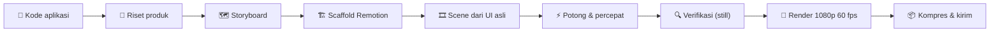

<div align="center">


<br>


<br><br>

**[Skill](#-skill-di-repo-ini)** &nbsp;·&nbsp; **[Pasang](#-pasang)** &nbsp;·&nbsp; **[Cara memakai](#-cara-memakai)** &nbsp;·&nbsp; **[Prasyarat](#-prasyarat)** &nbsp;·&nbsp; **[Struktur repo](#-struktur-repo)** &nbsp;·&nbsp; **[FAQ](#-faq)**

</div>

<br>

**open-skill** adalah kumpulan *skill* [Claude Code](https://claude.com/claude-code) buatan sendiri yang mengubah satu perintah
menjadi **video produk yang dirender dengan [Remotion](https://www.remotion.dev)**: demo sistem dari layar asli aplikasi, reel
motion graphic bergaya editorial, sampai video iklan lengkap dengan voice over dan sound effect.

Semuanya *video sebagai kode*: mulus 30-60 fps, bisa diulang, dan gampang diperbarui saat produk berubah.

---

## ✨ Skill di repo ini

<table>
  <tr>
    <td width="33%" valign="top">
      <a href="#-demotion"></a>
    </td>
    <td width="33%" valign="top">
      <a href="#-motion-reel"></a>
    </td>
    <td width="33%" valign="top">
      <a href="#-product-motion-ads"></a>
    </td>
  </tr>
</table>

| Skill | Hasil | Cocok untuk | Format |
|---|---|---|---|
| 🎬 **[demotion](skills/demotion)** | Rekaman layar **dari tampilan asli aplikasi**: kursor natural, zoom kamera, gulir halus, caption edukatif | Demo sistem, product tour, walkthrough fitur baru | 1080p · 60 fps · 1-2 menit |
| 📰 **[motion-reel](skills/motion-reel)** | Reel produk/fitur gaya editorial: kertas krem, tinta, highlighter, tipografi kinetik, SFX | Peluncuran fitur, promo singkat, explainer | 1080p · 30 fps · 20-45 dtk |
| 📣 **[product-motion-ads](skills/product-motion-ad)** | Iklan motion graphic mengikuti flow produk, dengan **voice over & SFX ElevenLabs** | Iklan SaaS/app/produk, video promo bersuara | 1080p · 30 fps · 30-45 dtk |

> Nama folder skill ketiga di repo ini adalah `product-motion-ad` (sama dengan nama skill-nya di Claude Code).

---

## 🎬 demotion

> **Demo sistem otomatis dari layar asli aplikasi.** Tampak seperti rekaman layar profesional ala Screen Studio, tetapi
> digerakkan sepenuhnya dari kode: tidak ada patah-patah rekaman, tidak ada take ulang.

<div align="center">
  
  <sub>Cuplikan dari video demo 1 menit 57 detik yang dibuat dengan <code>demotion</code> (landing, sambung WhatsApp, knowledge AI, live chat, statistik, pembayaran QRIS).</sub>
</div>

### Kenapa beda

- **UI asli, bukan tiruan.** Markup, kelas Tailwind, token warna, dan font disalin dari kode aplikasi; teks UI persis.
- **Kebenaran dari kode.** Setiap klaim di caption (harga, kuota, default) diverifikasi ke kode sebelum ditulis.
- **Gerak halus 60 fps.** Kursor melengkung natural, riak klik, zoom kamera otomatis, gulir mulus. Semua dihitung dari waktu video.
- **Product knowledge ikut tampil.** Caption menjelaskan *apa*, *kenapa*, dan *aturannya*, bukan cuma menunjuk tombol.
- **1-2 menit.** Bagian menunggu dipotong, pengetikan/loading dipercepat 3-8x (dengan lencana "4x").
- **Mudah diperbarui.** Fitur baru? Cukup perbarui scene terkait lalu render ulang.

### Alur kerja



### Contoh perintah

```text
Pakai skill demotion: buatkan video demo sistem ini dari tampilan asli, maksimal 2 menit.
```
```text
/demotion perbarui demo setelah fitur pembayaran QRIS ditambahkan
```

### Sekilas cara kerja mesinnya

Setiap scene adalah fungsi murni dari waktu; skrip hanya berisi *"kursor tiba di elemen ini pada detik sekian"*. Posisi kursor,
gulir, dan kamera diukur dari DOM pada frame yang dirender, jadi tidak pernah meleset walau tata letak berubah.

```ts
const script: Script = {
  cursor: [
    { at: 0,   to: [1100, 500] },
    { at: 2.0, to: "tombol-daftar", click: true },
    { at: 5.0, to: "isi-nama", kind: "text", click: true },
  ],
  scroll: [{ at: 0, to: 0 }, { at: 9.5, to: "sec-harga", align: -64, dur: 2 }],
  camera: [{ at: 0, zoom: 1 }, { at: 4.5, zoom: 1.35, focus: "isi-nama", dur: 1 }],
};
```

<details>
<summary><b>Isi skill & perintah yang disertakan</b></summary>

| Bagian | Fungsi |
|---|---|
| `SKILL.md` | Prinsip, 8 fase kerja, daftar jebakan |
| `templat/` | Engine siap pakai: `Stage` (jendela browser + kursor + kamera + gulir), caption, ponsel WhatsApp, peta potong/percepat, scene contoh |
| `skrip/scaffold.mjs` | Membuat proyek video lengkap dalam satu perintah |
| `skrip/lembar-kontak.py` | Lembar kontak video (satu gambar berisi cuplikan tiap N detik) untuk pemeriksaan visual |
| `skrip/kompres.mjs` | Salinan ringan (H.264) supaya muat dikirim |
| `skrip/bersihkan-proses.ps1` | Mematikan proses render Remotion yang tertinggal (mencegah render melambat 3x) |
| `referensi/` | Arsitektur engine, 23 jebakan + solusi, panduan storyboard & caption, templat brief subagent, render & kirim |

```bash
node ~/.claude/skills/demotion/skrip/scaffold.mjs --dest ./video --nama "Produk" --domain produk.com --aksen "#3ddc97" --install
```

</details>

---

## 📰 motion-reel

> **Reel produk bergaya editorial.** Kertas krem, tinta, highlighter, huruf sans tebal berpasangan dengan serif italik, bingkai HUD
> tipis, motion blur terarah, angka berputar, kartu bento 3D, tipografi kinetik di atas blok warna, logo reveal. Audio hanya SFX.

- Output **1920×1080 · 30 fps** MP4, satu file konfigurasi (`src/reel.config.ts`) mengatur seluruh video.
- **Warna bisa diganti**: pilih preset atau berikan hex; token lain diturunkan otomatis.
- Membaca teks asli produk dari kode (i18n, komponen halaman, README) supaya klaim di video benar; tidak mengarang metrik.

| Preset | Karakter |
|---|---|
| `lime` | tampilan referensi (bawaan) |
| `coral` · `ocean` · `sunset` · `violet` | variasi warna highlighter |
| `night` | versi gelap |
| `#hex` | warna merek sendiri (`accent`, lalu `secondary`, opsional `paper` & `ink`) |

**Rangkaian scene** (±45 dtk, pilih yang cocok): `spark` → `word` → `tagline` → `bento` → `checklist` → `steps` → `formula` →
`showcase` → `stats` → `kinetic` → `logo`. Versi pendek ±20 dtk: `spark` → `word` → `tagline` → `kinetic` → `logo`.

```text
/motion-reel Fitur pembayaran QRIS coral 30 detik
```

<details>
<summary><b>Alur & aturan gaya</b></summary>

1. **Baca permintaan** (produk/fitur, warna, bahasa copy), baca kode produk bila ada.
2. **Scaffold** `template/` → `npm install && npm run sfx`.
3. **Tulis `reel.config.ts`**: tema, scene, copy (batas panjang copy ada di `references/config.md`).
4. **Cek & render**: `tsc`, `npm run render`, `npm run frames` (lembar kontak tiap 1,5 dtk), perbaiki, render sekali lagi.
5. **Kirim** `out/reel.mp4` beserta ringkasan per scene.

Gaya: Inter Tight 800 untuk pernyataan, Instrument Serif italik untuk *twist*, JetBrains Mono untuk label/HUD; easing expo-out untuk
masuk, transisi smear/zoom-blur, tanpa guncangan dan tanpa kilatan putih.

</details>

---

## 📣 product-motion-ads

> **Video iklan motion graphic untuk produk apa pun** (SaaS, aplikasi, produk digital/fisik) dengan Remotion, lengkap dengan
> **voice over & sound effect dari ElevenLabs**. Urutan iklan mengikuti *flow pemakaian produk*, dan setiap scene membuktikan satu keunggulan.

- Output **1920×1080 · 30 fps · 30-45 detik**: hook kuat, VO yang terdengar manusia, SFX profesional, transisi cepat.
- **Produk jelas dalam 8 detik pertama**: nama produk + "melakukan apa untuk siapa".
- **Satu kalimat VO = satu scene = satu keunggulan + bukti visualnya** (form terisi, tombol diklik, kartu hasil muncul, angka naik).
- **Fakta dari sumber produk**: teks landing, onboarding, nama fitur di UI; angka ilustrasi dikabarkan sebagai ilustrasi.
- **Audio**: VO satu take → transkrip per kata (Scribe) → timeline otomatis (scene mulai tepat sebelum frasa pembukanya diucapkan) + paket 10 SFX.
- Bisa meniru **gaya transisi dari video referensi** (frame diekstrak lalu dianalisis).

```text
Buat video iklan 40 detik untuk produk ini dengan VO bahasa Indonesia dan SFX ElevenLabs.
```

<details>
<summary><b>Isi skill</b></summary>

| Bagian | Fungsi |
|---|---|
| `template/` | Proyek Remotion teruji: `primitives`, `scenes`, `Promo`, `theme`, penjadwalan VO/SFX |
| `references/script-and-storyboard.md` | Cara menulis naskah & storyboard (hook 3 ketukan, 1 baris ≤ 10 kata per scene) |
| `references/elevenlabs.md` | Membuat VO satu take, transkrip Scribe, dan paket SFX |
| `references/example-*.tsx.txt` | Contoh lengkap 13 scene dari proyek nyata |
| `scripts/contact-sheet.cjs` | Lembar kontak untuk pemeriksaan visual |

</details>

---

## 🚀 Pasang

Skill Claude Code adalah folder berisi `SKILL.md`. Salin folder skill ke `~/.claude/skills/` (tersedia di semua proyek) atau ke
`.claude/skills/` di dalam repo (khusus proyek itu).

<details open>
<summary><b>macOS / Linux</b></summary>

```bash
git clone https://github.com/rendydev404/open-skill.git
mkdir -p ~/.claude/skills
cp -r open-skill/skills/* ~/.claude/skills/
```

</details>

<details open>
<summary><b>Windows (PowerShell)</b></summary>

```powershell
git clone https://github.com/rendydev404/open-skill.git
New-Item -ItemType Directory -Force "$env:USERPROFILE\.claude\skills" | Out-Null
Copy-Item -Recurse -Force .\open-skill\skills\* "$env:USERPROFILE\.claude\skills\"
```

</details>

**Hanya satu skill?** Salin folder yang diinginkan saja, misalnya `skills/demotion`. **Memperbarui?** `git pull` lalu salin ulang.
Mulai ulang sesi Claude Code agar skill terbaca.

---

## 🧭 Cara memakai

Cukup minta dengan bahasa biasa; Claude akan memilih skill yang cocok dari deskripsinya. Atau panggil langsung dengan `/nama-skill`.

| Kamu bilang | Skill yang jalan |
|---|---|
| "Buatkan video demo sistem ini dari tampilan aslinya" | `demotion` |
| "Perbarui demo setelah ada fitur baru" | `demotion` |
| "Buat motion reel untuk fitur X, warna coral" | `motion-reel` |
| "Buat video iklan 40 detik + voice over untuk produk ini" | `product-motion-ad` |

---

## 🧰 Prasyarat

| Kebutuhan | Dipakai oleh | Catatan |
|---|---|---|
| [Claude Code](https://claude.com/claude-code) | semua | tempat skill dijalankan |
| Node.js (LTS) + npm | semua | Remotion, scaffold, render |
| FFmpeg | semua | sudah ikut di Remotion (`npx remotion ffmpeg`), tidak perlu pasang terpisah |
| GPU (opsional) | `demotion` | render dengan `--gl=angle` ±1,5x lebih cepat |
| Python 3 + Pillow (opsional) | `demotion` | untuk lembar kontak pemeriksaan visual |
| Akun & MCP [ElevenLabs](https://elevenlabs.io) | `product-motion-ad` | VO dan SFX |

---

## 📁 Struktur repo

```text
open-skill/
├── README.md
├── assets/                      # banner, kartu skill, kolase pratinjau
└── skills/
    ├── demotion/                # demo sistem dari layar asli
    │   ├── SKILL.md
    │   ├── referensi/           # arsitektur, jebakan, storyboard, brief fork, render
    │   ├── skrip/               # scaffold, lembar-kontak, kompres, bersihkan-proses
    │   └── templat/             # engine Remotion siap salin
    ├── motion-reel/             # reel editorial
    │   ├── SKILL.md
    │   ├── references/
    │   └── template/
    └── product-motion-ad/       # iklan + VO & SFX ElevenLabs
        ├── SKILL.md
        ├── references/
        ├── scripts/
        └── template/
```

---

## ❓ FAQ

<details>
<summary><b>Apa bedanya skill dengan plugin atau MCP?</b></summary>

Skill hanyalah instruksi + berkas pendukung yang dimuat Claude saat dibutuhkan. Tidak ada server atau proses yang berjalan.
`product-motion-ad` memakai MCP ElevenLabs untuk audio; dua skill lain tidak butuh layanan eksternal.

</details>

<details>
<summary><b>Di mana folder skills di Windows?</b></summary>

`C:\Users\<nama>\.claude\skills\` (di PowerShell: `$env:USERPROFILE\.claude\skills`).

</details>

<details>
<summary><b>Apakah demotion hanya untuk aplikasi tertentu?</b></summary>

Tidak. Engine-nya generik: kamu menyalin UI aplikasimu sendiri (Tailwind/React) ke scene. Contoh di README ini berasal dari
demo produk penulis, tetapi templat yang disertakan netral (`templat/src/scenes/contoh.tsx`).

</details>

<details>
<summary><b>Bisakah dipakai dengan agen selain Claude Code?</b></summary>

Isinya berkas Markdown + kode Remotion biasa, jadi instruksinya bisa dibaca agen lain. Penemuan otomatis lewat deskripsi
`SKILL.md` adalah fitur Claude Code.

</details>

---

<div align="center">

Dibuat oleh **[@rendydev404](https://github.com/rendydev404)** · Video dirender dengan **[Remotion](https://www.remotion.dev)**

<sub>Kalau repo ini membantu, kasih ⭐ ya.</sub>

</div>
